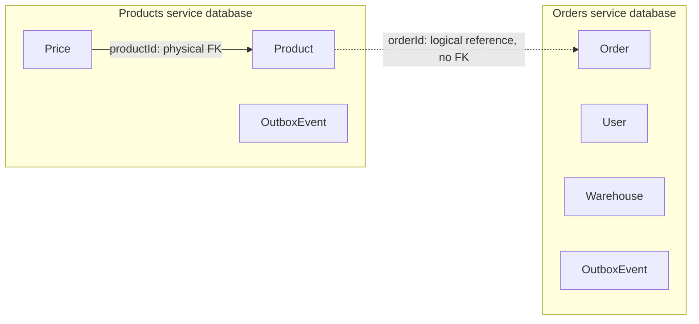

# Orders & Products

Inventory SPA built for the Orders & Products test assignment.

- Live application: [invertory.duckdns.org](http://invertory.duckdns.org)
- Repository: [dadi2008/Orders-Products](https://github.com/dadi2008/Orders-Products)
- Deployment: [Google Cloud VM and GitHub Actions guide](#deployment)
- Database model: [MySQL Workbench import instructions](#database-schema-and-mysql-workbench)

## Features and QA checklist

| Page                                   | Behavior                                                                                                                                                                                                                    |
| -------------------------------------- | --------------------------------------------------------------------------------------------------------------------------------------------------------------------------------------------------------------------------- |
| Arrivals (`/orders`)                   | Arrival titles, product counts, creation dates in two formats, totals grouped by currency, creation and deletion confirmation. Selecting an arrival opens its products alongside the list; the details panel can be closed. |
| Groups (`/groups`)                     | Separate arrival/group browser with product details, product creation and deletion.                                                                                                                                         |
| Products (`/products`)                 | All products, type filter, status, condition, guarantee dates, prices and linked arrival.                                                                                                                                   |
| Analytics (`/analytics`)               | Product value by type, calculated in a Web Worker; warehouse addresses and a map that centers on the selected warehouse.                                                                                                    |
| Warehouses (`/warehouses`)             | List warehouses and add a warehouse with its name/address. Coordinates are resolved using OpenStreetMap Nominatim; manual coordinates are available if address lookup fails.                                                |
| Users (`/users`)                       | Server-side search and pagination with 10 records per page.                                                                                                                                                                 |
| Settings (`/settings`)                 | Update the signed-in user's name/avatar. Saving disables the form and displays progress.                                                                                                                                    |
| Authentication (`/login`, `/register`) | Registration, login, refresh-token rotation and logout. Switching forms clears their values and errors.                                                                                                                     |

Product creation includes title, serial number, type, status, condition, a nonnegative USD price with up to two decimal places, and an optional PNG/JPEG/WebP image. Seeded products have USD and UAH prices; creating a product currently stores its entered USD price only, without automatic currency conversion.

The shared header provides search, language selection, server time and the active-session counter. Search is performed by the backend and debounced by 350 ms on the client. UI translations support Ukrainian, English and Russian; user-entered data and seed titles are not translated.

For a quick manual check, sign in with a demo account, open an arrival and close its details, filter products, create/delete a product, update the avatar and open the app in another tab to check the session counter.

## Technology and assignment coverage

| Requirement / approach                         | Implementation                                                                                                           |
| ---------------------------------------------- | ------------------------------------------------------------------------------------------------------------------------ |
| React, component architecture, ES6, TypeScript | React 19 SPA built with Vite and TypeScript; reusable UI components and feature pages                                    |
| Redux and routing                              | Redux Toolkit for shared UI state; React Router for pages and authentication routes                                      |
| CSS architecture/framework/animations          | BEM-style class names, Bootstrap, route/detail/modal animations and skeleton loading states                              |
| REST and GraphQL                               | Browser-to-gateway GraphQL using `graphql-request`; gateway-to-service REST using Axios; Fetch for address lookup        |
| Form validation                                | React Hook Form + Yup for authentication; browser/form checks and backend DTO validation for other inputs                |
| JWT and Web Storage                            | Passport JWT, rotating refresh tokens; localStorage for tokens/language and sessionStorage for browser-tab identity      |
| Lazy loading                                   | `React.lazy` and `Suspense` split page bundles                                                                           |
| Charts, maps, Web Workers                      | Product-value chart, OpenStreetMap warehouse map and a dedicated analytics worker                                        |
| PWA                                            | Web app manifest, service worker, cached application shell/assets, offline fallback and install controls where supported |
| Event-driven architecture                      | Kafka events, transactional outboxes, retries and dead-letter topics                                                     |
| Microservices                                  | Gateway, Orders, Products and Realtime NestJS services, with isolated Orders/Products databases                          |
| WebAssembly                                    | Small WebAssembly addition module used to calculate the product USD total                                                |
| Optimization                                   | Lazy page bundles, debounced server search, frontend response cache and Redis backend cache                              |
| Task runners, tests, Docker, Git               | npm scripts, Vitest, Playwright, Docker Compose and GitHub Actions                                                       |

**Scope limits:** this is a client-rendered SPA, not SSR/Next.js. The frontend is one Vite application with feature modules, not independently deployed microfrontends. These two assignment items are not implemented. The presence of Redis/Kafka/microservices does not establish the assignment's million-message/100k-user throughput target; no load-test result is claimed.

The PWA caches the shell and previously fetched assets/media. GraphQL writes and inventory data still require the backend; offline inventory editing/synchronization is not implemented. Service workers require HTTPS except on localhost.

## Run from a clean checkout with Docker

Prerequisites: Git, Docker Engine with Compose 2.24.4+ and OpenSSL (for generating secrets). Node.js is not required on the host for this path.

```bash
git clone https://github.com/dadi2008/Orders-Products.git
cd Orders-Products
cp .env.example .env
```

Before starting Docker, edit `.env` and replace these four placeholders:

| Variable                     | Required value                                          |
| ---------------------------- | ------------------------------------------------------- |
| `ORDERS_POSTGRES_PASSWORD`   | Random password for the Orders database                 |
| `PRODUCTS_POSTGRES_PASSWORD` | Different random password for the Products database     |
| `JWT_ACCESS_SECRET`          | Random signing secret, at least 32 characters           |
| `JWT_REFRESH_SECRET`         | Different random signing secret, at least 32 characters |

Run `openssl rand -hex 32` separately for each value and copy each result into the corresponding variable. Hex strings are also safe inside the database connection URLs. Do not commit `.env`.

Docker Compose builds internal database/service URLs automatically. The `*_DATABASE_URL` values in `.env.example` are for running Prisma/services outside Docker, and do not need to point at published database ports for the Docker-only path.

```bash
docker compose up -d --build --wait
docker compose ps -a
```

Open **http://localhost:3005**. Ports 3005 (web) and 3003 (local Socket.IO) must be available. Set `WEB_PORT` if the web port is occupied; if using a different public origin, also configure `WEB_ORIGIN`. PostgreSQL, Redis and Kafka are not published to host ports in the standard Compose configuration.

The `migrate` container applies both Prisma migration sets and seeds the databases before the dependent API services start. A completed `migrate`/`kafka-init` container with exit code 0 is expected.

### Initial data and login

Both local startup and production deployment ensure **four sample arrivals, six products and 20 demo users** exist:

- Email: `user1@inventory.local` through `user20@inventory.local`
- Initial password: `Inventory123!`

You can also register your own account. Seeds add missing records without overwriting existing users, passwords or product prices, and use actual arrival IDs. Demo credentials are public test credentials; consider this when exposing the QA deployment.

To inspect startup problems or rerun the seed:

```bash
docker compose logs --tail=100 migrate gateway orders-service products-service
docker compose run --rm --no-deps migrate npm run db:seed
```

Stop containers while retaining persisted data:

```bash
docker compose down
```

Only add `-v` if you intend to delete that Compose project's named volumes. Existing PostgreSQL credentials do not change merely by editing the password variables for an already initialized volume.

## Architecture and realtime behavior

The browser communicates with the gateway through `/graphql`. The gateway aggregates Orders and Products data through internal REST calls.

| Service             | Responsibility                                                | Docker endpoint                                 |
| ------------------- | ------------------------------------------------------------- | ----------------------------------------------- |
| `web`               | SPA, GraphQL/HTTP proxy and Socket.IO proxy                   | Host 3005 → container 3000 by default           |
| `gateway`           | Authentication, GraphQL aggregation, caching and uploads      | Internal 3000                                   |
| `orders-service`    | Arrivals, users/auth persistence, warehouses and order outbox | Internal 3001                                   |
| `products-service`  | Products/prices and product outbox                            | Internal 3002                                   |
| `realtime-service`  | Socket.IO presence and server-time events with Redis adapter  | 3003 locally; internal behind web in production |
| `orders-postgres`   | Orders-owned database                                         | Internal 5432                                   |
| `products-postgres` | Products-owned database                                       | Internal 5432                                   |
| `redis`             | Query cache and realtime coordination                         | Internal 6379                                   |
| `kafka`             | Inventory events and dead-letter topics                       | Internal 9092                                   |

`TopMenu` receives a server timestamp over Socket.IO every second and formats it using the selected locale and browser timezone. The counter counts authenticated connected browser-session IDs, not registered users; duplicate connections using the same ID are deduplicated. A tab stores its ID in sessionStorage. Realtime authentication uses the same access-token signing key as the gateway.

Deleting an arrival is eventually consistent: Orders persists the deletion and its outbox event in one transaction, then publishes `inventory.order.deleted`. Products consumes it in the `products-service-orders` group and removes the associated products. Outbox delivery includes retries and dead-letter handling.

The frontend cache is a per-tab in-memory Map with a 30-second TTL, query/variable keys, pending-request deduplication and invalidation after mutations. Gateway queries use Redis with a 60-second TTL, prefix invalidation, process-local pending requests and a Redis lock. The current lock/wait mechanism has timeout fallbacks; it is not an unlimited single-query guarantee under every failure or high-load scenario.

## Authentication, validation and media

Inventory operations require an access JWT. GraphQL exposes registration, login, refresh and logout. Access tokens expire after 15 minutes; refresh tokens expire after 7 days, rotate on refresh and are represented by a hash in the user record. Logout revokes the stored refresh token; previously issued access tokens can remain valid until expiry.

Authentication forms validate email and require passwords of at least eight characters. Backend DTO validation and Prisma parameterized queries provide server-side validation and database access. JWT signing secrets have no built-in defaults: missing/short secrets or identical access/refresh secrets prevent gateway startup. Secret rotation requires restarting the relevant containers and signing in again.

Uploaded images are stored locally:

- Local Compose: `./media` is created as needed and mounted into gateway/web.
- Production Compose: the persistent `media_data` Docker volume survives checkout and container updates.
- Replaced avatars and deleted product images are removed by the media lifecycle logic.
- `media/` and `.env` are ignored by Git; media/secrets are excluded from the Docker build context.

## Development outside Docker

Use Node.js **24** and npm. Provide PostgreSQL instances, Redis and Kafka reachable from the host; the standard Compose configuration does not expose its database ports. Copy `.env.example`, configure its connection URLs/secrets for those host-accessible services, and export the values into the processes running the applications.

```bash
npm ci
npm run db:generate
npm run db:migrate
npm run db:seed
npm run dev
```

The Vite server uses **http://localhost:3000**, the gateway uses **http://localhost:3100**, and the other APIs use ports 3001–3003. Vite proxies `/graphql` and `/api` to the gateway; the local frontend's Socket.IO URL defaults to `http://localhost:3003`. Configure origins/URLs for your development environment.

## Quality checks

Install dependencies and generate Prisma clients first. Install the Playwright browser before browser tests:

```bash
npm ci
npm run db:generate
npx playwright install chromium
```

| Command                                   | Scope                                                                     |
| ----------------------------------------- | ------------------------------------------------------------------------- |
| `npm run lint`                            | Workspace lint, backend-test lint/type checks and E2E lint/type checks    |
| `npm test`                                | Backend Vitest unit tests                                                 |
| `npm run test --workspace=@inventory/web` | Frontend Vitest component/library tests                                   |
| `npm run build`                           | TypeScript checks and builds for all workspaces                           |
| `npm run test:e2e`                        | Browser scenarios with controlled GraphQL responses                       |
| `npm run test:e2e:system`                 | Separate Docker Compose project and GraphQL/Kafka scenarios without mocks |

Frontend component tests and browser suites must be run separately; `npm test` alone is not a full frontend check. Browser scenarios include arrival creation/deletion, product deletion, search, type filtering and modal layout.

System E2E uses generated database passwords and a separate Compose project, then removes that project's containers/volumes. Required JWT values must still be available through the environment or `.env`. The script uses web port 3105 and inherits the Compose realtime port 3003; avoid running it alongside a local stack already using these ports.

Backend lint uses typed NestJS rules; Swagger rules are disabled because the API does not expose OpenAPI. Frontend lint uses TypeScript, React Hooks and React Refresh rules.

## Database schema and MySQL Workbench

The application runs **PostgreSQL**, with a separate database owned by each persistence service. MySQL is not required to run the application. The MySQL file is a review artifact for the test assignment's Workbench requirement.

### Files and source of truth

| File                                                                                       | Purpose                                                      |
| ------------------------------------------------------------------------------------------ | ------------------------------------------------------------ |
| [database-schema.mysql-workbench.sql](database-schema/database-schema.mysql-workbench.sql) | MySQL 8-compatible model that can be imported into Workbench |
| [Orders Prisma schema](backend/orders-service/prisma/schema.prisma)                        | Current Orders service models                                |
| [Products Prisma schema](backend/products-service/prisma/schema.prisma)                    | Current Products service models                              |

Runtime schema changes use the Prisma migration directories, not the Workbench SQL file. Update the Workbench model when changing Prisma models or migrations.

### Open the schema in Workbench

1. Open MySQL Workbench and create/open a model (**File → New Model**).
2. Choose **File → Import → Reverse Engineer MySQL Create Script**.
3. Select `database-schema/database-schema.mysql-workbench.sql`, using UTF-8 encoding.
4. Enable **Place imported objects on a diagram**.
5. Execute the import, inspect the results and finish the wizard.
6. Save the model with **File → Save** to obtain a native `.mwb` file.

No MySQL server connection is required for script import. **Database → Reverse Engineer** imports a live server instead. See the [official Workbench script-import instructions](https://dev.mysql.com/doc/workbench/en/wb-reverse-engineer-create-script.html).

The script uses two schema names, `orders_service` and `products_service`, to make service ownership visible in the model. The actual PostgreSQL databases are named `orders` and `products`, each using the `public` schema on its own server. Table/column names retain the Prisma names, including case.

### Tables and relationships

| Owner            | Tables                                      | Responsibility                                                                  |
| ---------------- | ------------------------------------------- | ------------------------------------------------------------------------------- |
| Orders service   | `Order`, `User`, `Warehouse`, `OutboxEvent` | Arrivals, account/profile data, warehouse locations and reliable event delivery |
| Products service | `Product`, `Price`, `OutboxEvent`           | Inventory items, currency-specific prices and reliable event delivery           |

There are **seven physical tables**, including two independent outboxes.



- `Price.productId` has a physical foreign key to `Product.id`, with delete/update cascade. `(productId, currency)` is unique.
- `Product.orderId` identifies an arrival owned by another service. There is deliberately **no cross-service SQL foreign key**. The gateway validates/aggregates this reference; Kafka propagates arrival deletions to Products. `orderTitle` is a denormalized copy used for product responses.
- User email and product serial number are unique. Arrival creation time, user creation time, product type/order ID and outbox delivery columns are indexed.
- Outboxes belong to their respective service databases. They do not have foreign keys to domain tables; event payloads are JSON snapshots.
- Warehouses store name, address, latitude and longitude. The current implementation does not assign products or users to a warehouse, so the model has no such relationship.

### PostgreSQL-to-MySQL adaptations

This is a representation of the implemented model, not a byte-identical PostgreSQL schema or a database migration to MySQL.

| PostgreSQL / Prisma implementation                                                        | Workbench representation                                                                                  |
| ----------------------------------------------------------------------------------------- | --------------------------------------------------------------------------------------------------------- |
| Separate PostgreSQL servers/databases                                                     | Two named MySQL schemas in one model                                                                      |
| `SERIAL` integer IDs                                                                      | `INT AUTO_INCREMENT`                                                                                      |
| `TIMESTAMP(3)` without timezone                                                           | `DATETIME(3)`; existing timestamp precision is retained                                                   |
| `JSONB` event payload                                                                     | MySQL `JSON`                                                                                              |
| PostgreSQL enum types                                                                     | Inline MySQL `ENUM` with the same values                                                                  |
| Indexed `TEXT` strings (`User.email`, `Product.serialNumber`, `Product.type`, outbox IDs) | `VARCHAR(255)` so MySQL can build full indexes; this imposes a length bound absent from PostgreSQL `TEXT` |
| `User.passwordHash` as `TEXT DEFAULT ''`                                                  | `VARCHAR(255) DEFAULT ''`, sufficient for the current hash format                                         |
| Other unconstrained strings                                                               | `TEXT`; explicit warehouse limits and `Price.currency VARCHAR(3)` retained                                |
| Prisma-managed `updatedAt` and UUID generation                                            | Application-managed fields; no invented MySQL update trigger or database UUID default                     |

Both outbox tables retain attempts, availability/lock timestamps, publication/dead-letter timestamps, last error and the composite delivery index. Only index names are shortened where useful for the review model. A nonnegative price is validated by the application; no additional database CHECK constraint is invented in these review files.

## API reference

GraphQL endpoint: `/graphql`. Supply `Authorization: Bearer <accessToken>` for protected operations.

| Category       | Operations                                                                 |
| -------------- | -------------------------------------------------------------------------- |
| Authentication | `register`, `login`, `refreshSession`, `logout`                            |
| Arrivals       | `orders(search)`, `order(id)`, `createOrder`, `deleteOrder`                |
| Products       | `products(type, search)`, `productTypes`, `createProduct`, `deleteProduct` |
| Users/profile  | `users(page, pageSize, search)`, `currentUser`, `updateCurrentUser`        |
| Warehouses     | `warehouses`, `createWarehouse`                                            |

`GET /api/health` remains available without authentication for readiness checks. Input/model declarations are under `backend/gateway/src/inventory/graphql/` and `backend/gateway/src/auth/graphql/`.

## Deployment

The workflow `.github/workflows/deploy.yml` runs build/tests on a GitHub-hosted runner for pull requests and pushes to `development`. After a successful push, deployment runs on a **self-hosted runner installed on the target Compute Engine VM**. Manual runs deploy only when the selected branch is `development`.

### Prepare the VM once

1. Create an x86-64 Linux Compute Engine VM with a persistent boot disk. The stack builds Node.js images and runs Kafka, two PostgreSQL instances, Redis and application services; provision sufficient RAM and disk space for these together.
2. Install Docker Engine, Docker Compose **2.24.4 or newer**, Git and curl. The runner account must have Docker access; verify `docker info` without sudo under that account.
3. In the repository, open **Settings → Actions → Runners → New self-hosted runner**. Follow the generated Linux x64 commands on the VM. Add the custom label **`gcp-production`** and install the runner as a system service so it survives VM restarts. Keep the runner software updated for the checkout action.
4. Create a GitHub Actions environment named **`production`**. Restrict its deployment branches to `development`; configure reviewers if required. Restrict who can push/merge into this branch, because that code executes on the server.
5. Configure the public hostname/IP and Google Cloud ingress rules for the web port. Only the web entry point needs public application ingress; PostgreSQL, Redis, Kafka and realtime remain internal. SSH is only needed for administration, not by this workflow.

For HTTPS, use a TLS reverse proxy or Google Cloud load balancer forwarding HTTP and WebSockets to the configured `WEB_PORT`. HTTPS is needed for the application's service worker/PWA outside localhost. Configure `WEB_ORIGIN` to the public HTTPS origin, not the internal VM address.

### GitHub secrets

Create these under **Settings → Environments → production → Environment secrets** (repository Actions secrets also work):

| Secret                       | Value                                                                                                      |
| ---------------------------- | ---------------------------------------------------------------------------------------------------------- |
| `ORDERS_POSTGRES_PASSWORD`   | Random database password, at least 24 characters using only letters, digits, `_`, `-`                      |
| `PRODUCTS_POSTGRES_PASSWORD` | A different random password with the same format                                                           |
| `JWT_ACCESS_SECRET`          | Random signing secret, at least 32 characters                                                              |
| `JWT_REFRESH_SECRET`         | A different random signing secret, at least 32 characters                                                  |
| `WEB_ORIGIN`                 | Public origin such as `https://inventory.example.com` or `http://VM_EXTERNAL_IP`, without a trailing slash |

Optionally add the environment **variable** `WEB_PORT` (default `80`). If an existing reverse proxy uses port 80, set a different port such as `8080` and forward to it.

Secrets are passed to Compose as process environment variables. The workflow does not generate a `.env` file or print the resolved Compose configuration. Docker still retains runtime environment values in container metadata accessible to administrators with Docker access. No Google Cloud JSON key or SSH key is needed because the runner executes directly on the VM.

### Deployment behavior

- Node.js 24 matches the Docker image. CI installs dependencies, generates Prisma clients, builds all workspaces and runs the backend Vitest suite.
- Pull requests use GitHub-hosted runners and never run the deployment job or receive deployment secrets.
- Production deploys are serialized to avoid simultaneous Compose updates.
- Images are built on the VM from the checked-out commit; no container registry setup is needed.
- Compose runs migrations and seeds before starting dependent services, in both local and production configurations. Seeds ensure four sample arrivals, six products and 20 demo users exist. Existing users and products are preserved, including their passwords and prices; missing seed records are added without duplicating existing records. Products reference the actual seeded arrival IDs, including on databases that already contain user-created arrivals.
- Demo accounts `user1@inventory.local` through `user20@inventory.local` initially use password `Inventory123!`. These are test accounts intended for QA; their known credentials must be considered before making this demo deployment publicly accessible.
- PostgreSQL data and uploaded media use persistent named Docker volumes in the fixed Compose project `orders-products-production`. Checkout cleanup does not delete them.
- The web image uses same-origin GraphQL and Socket.IO; the browser does not connect to `localhost:3003` on users' computers.
- The workflow waits for Compose readiness, then checks the web and health endpoints.
- Deployments update containers in place without `docker compose down`. Brief interruption is possible; this is not a zero-downtime deployment. A failed migration stops deployment; automatic database rollback is not attempted.

Never run `docker compose down -v` on this deployment unless you intend to delete its data. Back up PostgreSQL volumes and media before production migrations. Changing database password secrets does not rotate credentials inside an existing PostgreSQL volume; perform database password rotation separately.

Local development continues to use `docker compose up -d --build` with the original Compose file. To administer production manually, use the same project name and both configuration files, with the required environment variables supplied:

```bash
docker compose -p orders-products-production \
  -f docker-compose.yml -f docker-compose.production.yml ps
```

The files prepare deployment but do not create the VM, configure DNS/TLS/firewall rules or register the runner. The first deployment starts after those steps and a push to `development`.

### Existing system Nginx

If Nginx already listens on port 80, set the GitHub environment variable `WEB_PORT=3005` and configure its virtual host to proxy the public domain to `http://127.0.0.1:3005`, including WebSocket upgrade headers. Set `client_max_body_size 8m` to allow image uploads. Set `WEB_ORIGIN` to the public origin, for example `http://invertory.duckdns.org`, without a trailing slash; use `https://` after configuring TLS. The browser accesses the public domain, not the internal port. Port 3005 does not need public Google Cloud firewall ingress when only the local reverse proxy uses it.
